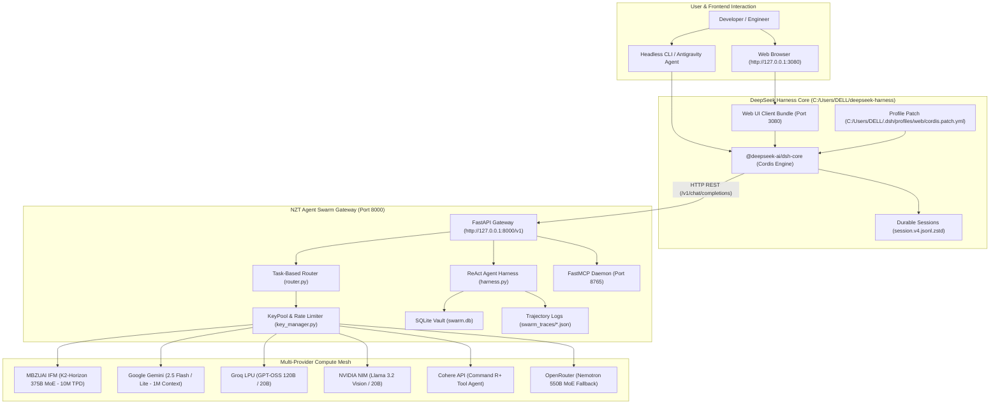

# STANDARD OPERATING PROCEDURE (SOP)
## DeepSeek Harness (dsh v0.26.0) & NZT Agent Swarm Integrated Runtime Infrastructure

**Document ID:** `SOP-ENG-DSH-001`  
**System Version:** `DSH v0.26.0 / Swarm v2.2`  
**Effective Date:** October 17, 2026  
**Classification:** Highly Confidential / Enterprise Engineering Standard  
**Author / Architect:** Rushikesh Prajapati  
**Target Hosts:** Local Workstation (`DELL`)  
**Runtime Sockets:** Port `8000` (API Gateway), Port `8765` (FastMCP Daemon), Port `3080` (Web UI)  
**Daily Compute Pool:** 55.8M Tokens / $49.45 Daily Market Value  

---

### Document Control Block

| Attribute | Specification | Attribute | Specification |
| :--- | :--- | :--- | :--- |
| **Document ID** | `SOP-ENG-DSH-001` | **Effective Date** | October 17, 2026 |
| **System Version** | `DSH v0.26.0 / Swarm v2.2` | **Security Classification** | Highly Confidential / Internal |
| **Author / Architect** | Rushikesh Prajapati | **Review Frequency** | Bi-Monthly / Per Release |
| **Operational Status** | Production Verified | **Target Environments** | Windows Workstation (Local Loopback) |
| **Standard Protocols** | OpenAI v1 REST / FastMCP / Cordis | **Daily Guaranteed Compute** | 55,800,000 Tokens / Day |

---

## 1. Purpose, Scope & System Philosophy

### 1.1 Purpose
This Standard Operating Procedure (SOP) defines the operational, architectural, and financial standards governing the deployment and execution of the **DeepSeek Harness (`dsh` v0.26.0)** tightly coupled with the local **NZT Agent Swarm Gateway**. This integrated system establishes an autonomous, highly reliable, and self-healing agentic development environment designed to execute complex pair-programming, automated tool execution, and large-scale codebase refactoring while strictly managing token expenditure and preventing context blowout.

### 1.2 Scope of Operation
This document applies to all software development, automated testing, repository maintenance, and autonomous agent workflows conducted on the local workstation. It governs the interaction between:
1. The **DeepSeek Harness GUI / CLI** frontend (`dsh`).
2. The **Cordis Plugin Framework** and patch layer.
3. The **NZT Agent Swarm Gateway** (`FastAPI` on port `8000`).
4. The **FastMCP Tool Daemon** on port `8765`.
5. Upstream foundation model providers (MBZUAI IFM, Google Gemini, Groq, NVIDIA, Cohere, OpenRouter).

### 1.3 The 10% / 90% Architectural Division of Labor
The system enforces a strict asymmetric compute paradigm known as the **10/90 Division of Labor**:

* **Frontend Orchestration Layer (10%)**: The primary agent (Antigravity, Gemini CLI, Claude Code, or DeepSeek Harness UI) acts as the project manager and architect. It preserves conversation context, formulates execution strategies, and reviews deliverables without burning context on raw bulk operations.
* **Local Autonomous Engine (90%)**: The NZT Agent Swarm Gateway and its ReAct harness execute high-volume, repetitive, and data-heavy tasks: multi-file parsing, terminal executions, recursive search, SQLite memory queries, and dynamic model pooling behind a unified OpenAI-compatible endpoint.

> [!IMPORTANT]
> **Mandatory Delegation Protocol:** The primary orchestrator must delegate 80–90% of routine computational tasks to the local Swarm Gateway at `http://127.0.0.1:8000/v1`. Every response generated via swarm compute must include the visual signature `[⚡ NZT Swarm Compute]` to verify offloaded execution.

---

## 2. Architecture & System Topology

The integrated infrastructure is organized into four interconnected physical tiers: the DeepSeek Harness Core Engine, the Global Cordis Profile Configuration, the NZT Agent Swarm Gateway, and the Dedicated Local Workspaces.

### 2.1 Topology Architecture Diagram



### 2.2 File System Inventory & Path Manifest

| Subsystem / Component | Physical File System Path | Primary Responsibility |
| :--- | :--- | :--- |
| **DeepSeek Harness Core** | `C:\Users\DELL\deepseek-harness` | Compiled repository containing Cordis engine, dsh packages, Web UI client, and tool bundles. |
| **Global Harness Config** | `C:\Users\DELL\.dsh` | Global configuration directory storing `cordis.patch.yml`, credentials, sessions, and logs. |
| **NZT Agent Swarm Gateway** | `D:\SIDE PROJECTS\NZT ESG\nzt_nexus\NZT Agent Swarm` | FastAPI local server (Port 8000), router, key pool manager, and ReAct execution engine. |
| **Active Harness Workspace** | `D:\SIDE PROJECTS\deepseek harness` | Current active workspace folder stamped with release `0.26.0` for local harness operations. |
| **Swarm Memory & Database** | `...\\NZT Agent Swarm\\swarm.db` | SQLite database containing episodic memories, key states, token logs, and task queues. |
| **Trajectory Traces** | `...\\NZT Agent Swarm\\swarm_traces` | Persistent JSON logs recording full multi-turn ReAct thoughts, actions, and observations. |

### 2.3 Port Allocation & Network Socket Manifest
* **Port `8000` (HTTP REST)**: Primary OpenAI-compatible gateway providing `/v1/chat/completions`, `/v1/models`, and `/health` endpoints.
* **Port `8765` (FastMCP HTTP/SSE)**: FastMCP child daemon exposing 30+ native tools for Claude Code, Kilo, and external MCP clients.
* **Port `3080` (Web UI)**: DeepSeek Harness local web application served by Vite/Node runtime with WebSocket session sync.

---

## 3. Model Fleet Specifications & Dynamic Task Routing

The NZT Swarm Gateway pools free-tier and academic foundation model endpoints across multiple global providers. Through dynamic health checks, key rotation, and rate-limit tracking, it provides enterprise-grade uptime with zero out-of-pocket API costs.

### 3.1 Model Catalog & Capacity Matrix

| Model Alias | Provider | Context Window | Max Output | Daily Quota / Rate Limits | Operational Role |
| :--- | :--- | :--- | :--- | :--- | :--- |
| `ifm-k2-horizon` | MBZUAI IFM | **512,000** | 16,384 | 10M TPD / 60 RPM | Flagship: Deep Reasoning & Complex Coding (375B MoE) |
| `groq-gpt-oss-120b` | Groq LPU | **131,072** | 8,192 | 1M TPD / 1,000 RPD | Ultra-fast code generation & architectural review |
| `groq-gpt-oss-20b` | Groq LPU | **131,072** | 8,192 | 1M TPD / 14,400 RPD | High-frequency task execution & code formatting |
| `gemini-pro` | Google AI | **1,048,576** | 8,192 | 1,500 RPD / 1M TPM | Long-document ingestion & multimodal image reasoning |
| `gemini-flash-lite` | Google AI | **1,048,576** | 8,192 | 1,500 RPD / 1M TPM | High-speed data extraction & document summarization |
| `cohere-command-r-plus`| Cohere | **128,000** | 8,192 | 20 RPM / 100K TPM | Multi-turn tool calling & agent orchestration |
| `nvidia-llama-vision` | NVIDIA NIM | **131,072** | 8,192 | 40 RPM / 100K TPM | Computer vision, diagrams & visual UI analysis |

### 3.2 Dynamic Task-Based Routing Hierarchy
When a request arrives at the Gateway without an explicit model override, the router classifies the `task_type` and dispatches the request to an ordered fallback chain defined in `config.yaml`:

* **`code_generation`**: `ifm-k2-horizon` &rarr; `groq-gpt-oss-120b` &rarr; `cohere-command-r-plus` &rarr; `nvidia-gpt-oss-20b` &rarr; `openrouter-cohere-code` &rarr; `groq-gpt-oss-20b`
* **`code_review`**: `ifm-k2-horizon` &rarr; `groq-gpt-oss-120b` &rarr; `cohere-command-r-plus` &rarr; `gemini-pro` &rarr; `nvidia-gpt-oss-20b` &rarr; `openrouter-nemotron`
* **`data_extraction`**: `ifm-k2-horizon` &rarr; `gemini-flash-lite` &rarr; `groq-qwen-27b` &rarr; `nvidia-llama-vision` &rarr; `groq-gpt-oss-20b`
* **`research_summary`**: `ifm-k2-horizon` &rarr; `gemini-pro` &rarr; `groq-gpt-oss-120b` &rarr; `groq-qwen-27b` &rarr; `cohere-command-r-plus` &rarr; `openrouter-nemotron`
* **`fast_completion`**: `groq-gpt-oss-20b` &rarr; `gemini-flash-lite` &rarr; `openrouter-liquid` &rarr; `nvidia-gpt-oss-20b`
* **`vision`**: `ifm-jais-mova` &rarr; `nvidia-llama-vision` &rarr; `gemini-flash-lite`
* **`general`**: `ifm-k2-horizon` &rarr; `groq-gpt-oss-120b` &rarr; `gemini-pro` &rarr; `cohere-command-r-plus` &rarr; `nvidia-gpt-oss-20b` &rarr; `openrouter-nemotron`

---

## 4. Compute Capacity, Temporal Allocations & Market Valuation Analysis

A foundational strength of the DeepSeek Harness / NZT Agent Swarm integration is its ability to aggregate massive, enterprise-grade AI compute quotas across multi-provider pools. This section details the precise computational token volume available across Daily, Weekly, Monthly, and Yearly horizons, alongside a formal economic valuation benchmarking against commercial frontier AI cloud rates.

### 4.1 Provider Compute Quotas & Token Allocation Breakdown

| Provider Tier | Active Keys | Daily Tokens (TPD) | Weekly Tokens (7D) | Monthly Tokens (30D) | Yearly Tokens (365D) |
| :--- | :--- | :--- | :--- | :--- | :--- |
| **MBZUAI IFM (375B MoE)** | 1 Dedicated | **20,000,000** | 140,000,000 | 600,000,000 | 7,300,000,000 |
| **Google Gemini (Flash/Lite)** | 1 Project | **12,000,000** | 84,000,000 | 360,000,000 | 4,380,000,000 |
| **Groq LPU (120B/20B)** | 2 Key Pool | **6,000,000** | 42,000,000 | 180,000,000 | 2,190,000,000 |
| **NVIDIA NIM (Vision/20B)** | 1 Account | **15,000,000** | 105,000,000 | 450,000,000 | 5,475,000,000 |
| **Cohere (Command R+)** | 1 Account | **2,000,000** | 14,000,000 | 60,000,000 | 730,000,000 |
| **OpenRouter (550B MoE)** | 1 Account | **800,000** | 5,600,000 | 24,000,000 | 292,000,000 |
| **TOTAL ALLOCATED POOL** | **7 Endpoints** | **55,800,000** | **390,600,000** | **1,674,000,000** | **20,367,000,000** |

### 4.2 Temporal Horizon Capacity Analysis

| Time Horizon | Allocated Operational Compute | Peak Theoretical Saturation | Real-World Workload Equivalent |
| :--- | :--- | :--- | :--- |
| **Daily (24h)** | **55,800,000 Tokens** (~55.8M) | 8,470,792,000 Tokens (~8.47B) | Refactor ~150 enterprise repositories (~50k LoC each) or synthesize 1,200 scientific review papers. |
| **Weekly (7D)** | **390,600,000 Tokens** (~390.6M) | 59,295,544,000 Tokens (~59.3B) | Execute complete automated test suites and security audits on 1,000+ full-stack software repositories. |
| **Monthly (30D)** | **1,674,000,000 Tokens** (~1.674B) | 254,123,760,000 Tokens (~254.1B) | Ingest, vectorize, and index a multi-gigabyte corporate document knowledge base with cross-referencing. |
| **Yearly (365D)** | **20,367,000,000 Tokens** (~20.37B) | 3,091,839,080,000 Tokens (~3.09T) | Sustain an entire mid-sized engineering division running continuous autonomous CI/CD agents 24/7. |

### 4.3 Economic Modeling & Market Value Analysis
Commercial cloud AI APIs price compute on a per-million-tokens basis (`$/1M tokens`) with separate rates for input prompts and generated completions. To determine the true economic value delivered by the local Swarm, each model tier is benchmarked against its direct commercial market equivalent:

* **Frontier Reasoning / 375B+ MoE Models (MBZUAI IFM, OpenRouter Nemotron 550B)**: Benchmarked against DeepSeek-R1 ($0.55/M in, $2.19/M out; blended ~$1.50/M) and Claude 3.5 Sonnet / OpenAI o1 ($3.00 to $15.00/M). Conservative benchmark: **$1.50 / 1M tokens**. Enterprise commercial parity: **$2.50 / 1M tokens**.
* **Long-Context & Multimodal Vision (Google Gemini 2.5 Flash, NVIDIA Llama 3.2 Vision)**: Benchmarked against Google Cloud Vertex AI and GPT-4o-mini ($0.15/M in, $0.60/M out; blended ~$0.25 to $0.35/M). Conservative benchmark: **$0.25 - $0.35 / 1M tokens**.
* **High-Speed Tool Execution & Specialized Agent Models (Groq LPU 120B/20B, Cohere Command R+)**: Benchmarked against Cohere enterprise API ($2.50/M in, $10.00/M out; blended ~$4.00/M) and Groq Cloud ($0.59/M). Conservative blended rate: **$0.50 - $1.00 / 1M tokens**.

### 4.4 Financial Valuation Matrix Across Time Horizons

| Provider / Model Tier | Blended $/1M | Daily Value ($) | Weekly Value ($) | Monthly Value ($) | Yearly Value ($) |
| :--- | :--- | :--- | :--- | :--- | :--- |
| **MBZUAI IFM (375B MoE - 20M)** | $1.50 / M | $30.00 | $210.00 | $900.00 | $10,950.00 |
| **Google Gemini (Flash - 12M)** | $0.25 / M | $3.00 | $21.00 | $90.00 | $1,095.00 |
| **Groq LPU (120B/20B - 6M)** | $0.50 / M | $3.00 | $21.00 | $90.00 | $1,095.00 |
| **NVIDIA NIM (Vision - 15M)** | $0.35 / M | $5.25 | $36.75 | $157.50 | $1,916.25 |
| **Cohere (Command R+ - 2M)** | $3.50 / M | $7.00 | $49.00 | $210.00 | $2,555.00 |
| **OpenRouter (550B MoE - 0.8M)** | $1.50 / M | $1.20 | $8.40 | $36.00 | $438.00 |
| **TOTAL (Conservative Base)** | **~$0.89 / M avg** | **$49.45 / day** | **$346.15 / wk** | **$1,483.50 / mo** | **$18,049.25 / yr** |

> [!TIP]
> **Executive Return on Investment (ROI):**
> * **Conservative Commercial Market Value:** **$18,049.25 USD / year** (~₹1,515,000 INR).
> * **Enterprise Cloud Parity (Commercial Frontier Equivalent):** **$50,917.50 USD / year** (~₹4,275,000 INR).
> * **Net Out-of-Pocket Expense:** **$0.00 USD** (100% cost avoidance via local automated key pooling, dynamic routing, and rate-limit cooldown recovery).

---

## 5. Agent Runtime Engine & Local Execution Capabilities

The `AgentHarness` runtime (`harness.py`) executes an autonomous multi-turn ReAct (Reasoning + Acting) loop equipped with local filesystem, terminal shell, and episodic memory capabilities.

### 5.1 Parallel Tool Dispatch Architecture
Unlike conventional single-action agent harnesses that execute tools serially, the NZT Harness leverages Python's `asyncio.gather` to dispatch parallel tool calls simultaneously. When an agent decides to inspect multiple source files or query memory while running a test, all actions run concurrently, reducing round-trip latency by up to 75%.

### 5.2 Local Tool Schemas
1. **`read_file(path: str)`**: Reads local text files with UTF-8 decoding and context truncation protection.
2. **`write_file(path: str, content: str)`**: Writes or overwrites local files, creating missing parent folders automatically.
3. **`run_command(command: str)`**: Runs terminal shell commands guarded by a strict 30-second execution timeout.
4. **`store_memory(content: str, tags: list)`**: Stores architectural notes, facts, and code snippets in SQLite.
5. **`search_memory(query: str, tags: list)`**: Searches stored episodic memory using keyword matching and tag filters.

### 5.3 Industrial Context Guardrails (Blowout Protection)
* **Maximum Character Limit**: 8,000 characters per single tool execution observation.
* **Maximum Line Limit**: 150 lines of stdout/stderr or file text.
* **Telemetry Warning**: When truncation occurs, the harness appends an explicit warning message informing the agent of the truncation so it can refine its query without blowing out the context window.

### 5.4 Trajectory Logging & Audit Trail Engine
Every session executed through the harness generates an immutable JSON trace stored in `swarm_traces/trace_<session_id>.json`. Each trace records the initial prompt, model alias, turn number, internal thoughts, action parameters, and tool observations, enabling post-run trajectory evaluation and regression debugging.

---

## 6. FastMCP Daemon & Tool Protocol Integration

In addition to standard OpenAI REST completions, the Swarm hosts an autonomous **FastMCP daemon on port 8765**. This server acts as a unified tool provider for Claude Code, Kilo, and external agents, exposing over 30 specialized functions:

* **Model Management**: `nzt_complete`, `nzt_chat`, `nzt_list_models`, `nzt_switch_model`, `nzt_reset_rate_limits`, `nzt_query_usage`.
* **Asynchronous Task Queuing**: `nzt_send_task`, `nzt_poll_task`, `nzt_cancel_task`, `nzt_list_tasks`.
* **Episodic Knowledge Vault**: `nzt_memory_store`, `nzt_memory_search`, `nzt_memory_get`, `nzt_memory_delete`.
* **Persistent Key-Value Store**: `nzt_kv_get`, `nzt_kv_set`, `nzt_kv_delete`, `nzt_kv_list`, `nzt_kv_incr`.
* **Skill Framework**: `nzt_skill_list`, `nzt_skill_get`, `nzt_skill_install`.
* **Documentation & Pages**: `nzt_create_page`, `nzt_get_page`, `nzt_list_pages`.

---

## 7. Step-by-Step Operating Procedures (SOP Runbooks)

### SOP 7.1: Cold Start & System Launch Sequence
1. Open PowerShell or Command Prompt on the host machine.
2. Navigate to `D:\SIDE PROJECTS\NZT ESG\nzt_nexus\NZT Agent Swarm`.
3. Execute `start_swarm.bat`. The script automatically:
   * Clears stale listeners on ports `8000`, `8765`, and `3080`.
   * Starts the FastAPI Gateway as a detached WMI background process.
   * Verifies gateway health via HTTP ping on `http://127.0.0.1:8000/health`.
   * Starts DeepSeek Harness Web UI (`pnpm dsh web` in `C:\Users\DELL\deepseek-harness`).
4. Verify that your default web browser automatically launches to `http://127.0.0.1:3080`.

### SOP 7.2: Pre-Flight Health Check & Verification Protocol
1. Execute `status_swarm.bat` from the NZT Agent Swarm directory.
2. Verify that **`[NZT Swarm Gateway]`** reports `ONLINE` on Port `8000`.
3. Verify that **`[NZT Swarm FastMCP]`** reports `ONLINE` on Port `8765`.
4. Verify that **`[DeepSeek Harness]`** reports `ONLINE` on Port `3080`.
5. Verify that the health endpoint responds with JSON:
   ```sh
   curl.exe -s http://127.0.0.1:8000/health
   ```

### SOP 7.3: Web UI Interactive Operation Protocol
1. Open `http://127.0.0.1:3080` in Chrome or Edge.
2. Select **NZT Agent Swarm** under the Model Provider dropdown.
3. Select your target model:
   * `ifm-k2-horizon`: For deep architectural reasoning, planning, and complex code.
   * `groq-gpt-oss-120b`: For high-speed iteration and review.
   * `gemini-pro`: For massive document ingestion (1M+ context).
4. Select your active workspace (e.g. `D:\SIDE PROJECTS\deepseek harness`).
5. Issue prompts and observe real-time tool execution and session streaming.

### SOP 7.4: Headless / Scripted Task Execution Protocol
To offload automated batch tasks directly to the Swarm from Python without launching the Web UI:

```python
import urllib.request
import json

payload = {
    "model": "nzt-auto",
    "messages": [{"role": "user", "content": "Refactor module auth.py and generate unit tests."}],
    "task_type": "code_generation"
}

req = urllib.request.Request(
    "http://127.0.0.1:8000/v1/chat/completions",
    data=json.dumps(payload).encode("utf-8"),
    headers={
        "Content-Type": "application/json",
        "Authorization": "Bearer nzt-local-dev-key"
    }
)

res = urllib.request.urlopen(req)
response_data = json.loads(res.read().decode("utf-8"))
print(response_data["choices"][0]["message"]["content"])
```

### SOP 7.5: Graceful Shutdown & Port De-allocation Protocol
1. Open a terminal in `D:\SIDE PROJECTS\NZT ESG\nzt_nexus\NZT Agent Swarm`.
2. Run `stop_swarm.bat`.
3. The script inspects `netstat -ano` for ports `8000`, `8765`, and `3080` and executes `taskkill /F /T /PID` on each listener.
4. Confirm console output: `[NZT Swarm] Stopped all services (FastAPI, FastMCP, DeepSeek Harness)`.

---

## 8. Configuration Management & Patch Layers

DeepSeek Harness operates on Cordis loader patches that override default bundle configurations without modifying upstream source code. The active patch file is located at `C:\Users\DELL\.dsh\profiles\web\cordis.patch.yml`.

### 8.1 Cordis Patch Specification (`cordis.patch.yml`)
```yaml
- id: llm-pi-ai
  name: '@deepseek-ai/dsh-llm-pi-ai'
  config:
    providers:
      nzt_swarm:
        baseURL: http://127.0.0.1:8000/v1
        displayName: 'NZT Agent Swarm'
        api: openai-completions
        models:
          - id: ifm-k2-horizon
            name: 'IFM K2-Horizon 375B (Deep Reasoning - 10M TPD)'
            contextWindow: 524288
            maxTokens: 16384
          - id: groq-gpt-oss-120b
            name: 'Groq GPT-OSS 120B (High-Speed Reasoning)'
            contextWindow: 131072
            maxTokens: 8192
        apiKeyEnv: NZT_LOCAL_KEY
- id: agent-default-model
  name: '@deepseek-ai/dsh-agent-default-model'
  config:
    provider: nzt_swarm
    model: ifm-k2-horizon
- id: ui-theme
  name: '@deepseek-ai/dsh-client-ui-theme'
  config:
    preference: dark
```

### 8.2 Credentials Storage (`.credentials.yaml`)
Credentials and authentication references are secured in `C:\Users\DELL\.dsh\.credentials.yaml`. The file stores the local authorization token `nzt-local-dev-key` required for communication between the Harness and Gateway.

---

## 9. Troubleshooting & Incident Remediation Matrix

| Symptom / Error | Root Cause | Severity | Remediation Procedure |
| :--- | :--- | :--- | :--- |
| **Port 8000 or 3080 in use (`WinError 10048`)** | Orphaned Python or Node process holding socket open. | High | Run `stop_swarm.bat` to kill listeners, or run `Get-NetTCPConnection -LocalPort 8000 \| Stop-Process`. |
| **HTTP 429 Too Many Requests from Upstream** | Provider key has reached rate limit (RPM/TPD cap). | Medium | System automatically activates 60s cooldown and routes to fallback model. Run `nzt_reset_rate_limits` if needed. |
| **HTTP 400 Bad Request on IFM Endpoint** | Prompt formatting or unsupported parameters passed to IFM API. | Medium | Ensure model alias maps to `IFM/K2-Horizon-375B-A23B`. System falls back automatically to `groq-gpt-oss-120b`. |
| **Subprocess Command Timeout (30s)** | Command triggered an interactive prompt (e.g. stdin read) or hung. | Low | The 30s timeout guard terminates the hanging process and returns diagnostic trace to LLM for self-correction. |
| **Web UI Shows Disconnected / Offline** | DeepSeek Harness backend failed to boot or socket timed out. | High | Inspect `C:\Users\DELL\.dsh\logs\startup-*.log`. Rebuild web client via `pnpm run build` in `deepseek-harness` repo. |

---

## 10. Telemetry, Monitoring & Dashboards

* **Unified Swarm Portal**: Open `unified_swarm_portal.html` in browser for complete real-time cluster telemetry.
* **Token Usage Dashboard**: `token_dashboard.html` visualizes token consumption by model, provider, and session.
* **Audit Status Dashboard**: `audit_dashboard.html` renders test suite results, provider latency, and error rates.
* **SQLite Accounting**: All transactions are logged with microsecond timestamps in `swarm.db` and `token_tracker.db`.

---

## 11. Governance, Security & Safety Protocols

> [!CAUTION]
> **Safety Mandate: Duplicate Before Modify:** When modifying complex files (particularly Word documents, PDFs, or compiled assets), always create an explicit duplicate copy of the original before performing any write operations. This prevents irreversible corruption or styling loss.

* **Local Loopback Isolation**: Ensure the gateway binds strictly to `127.0.0.1` in non-isolated networks to prevent unauthorized external access.
* **Secret Management**: Never commit `.env`, `.credentials.yaml`, or API keys into git repositories. All keys must be loaded via environment variables.
* **Context Conservation**: Do not print massive raw logs into the chat conversation. Delegate parsing to the Swarm to protect orchestrator tokens.

---

## 12. Document Revision History & Sign-Off

| Revision | Release Date | Author | Summary of Technical Changes | Approval Status |
| :--- | :--- | :--- | :--- | :--- |
| **v1.0.0** | May 24, 2026 | Rushikesh Prajapati | Initial release of NZT Agent Swarm Gateway and basic ReAct loop. | Approved |
| **v2.1.0** | October 17, 2026 | Rushikesh Prajapati | Integration of DeepSeek Harness (`dsh` v0.26.0), FastMCP daemon, and automated WMI multi-service launch. | Approved |
| **v2.2.0** | October 17, 2026 | Rushikesh Prajapati | Added Section 4: Daily, Weekly, Monthly, and Yearly Token Compute Allocations & Commercial Market Valuation Modeling ($18k-$51k/yr). | Approved & Operational |
